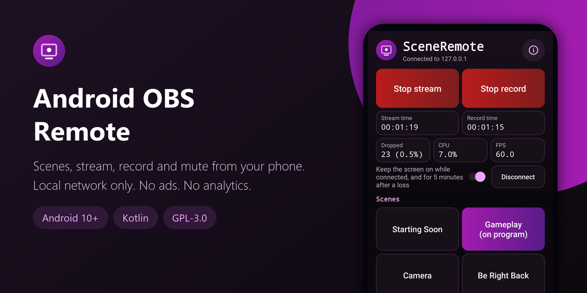
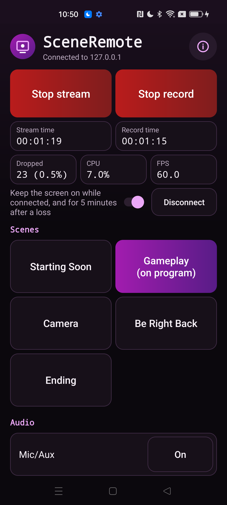
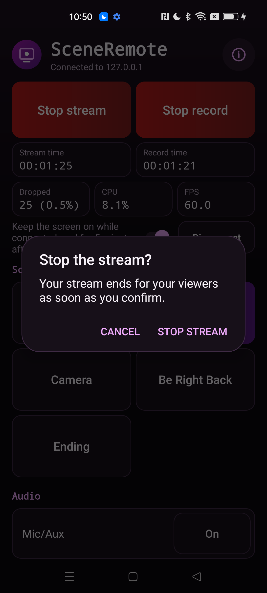
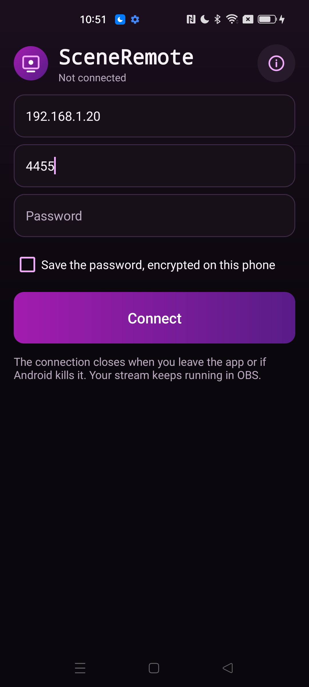
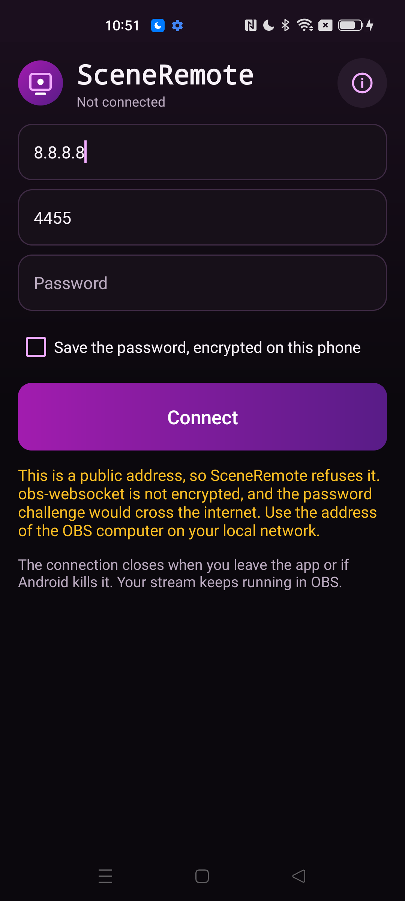
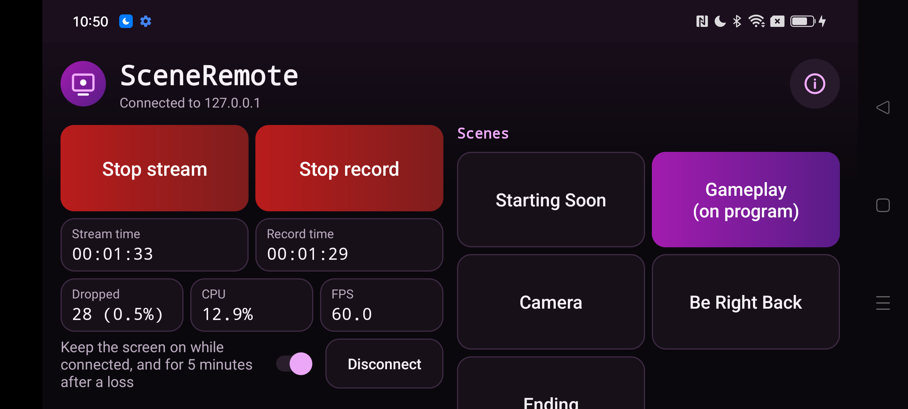

<div align="center">



# Android OBS Remote

**Control OBS Studio from your phone on your local network: switch scenes, start and stop the stream and the recording, mute audio inputs and watch live stats. Open source, no ads, no analytics.**

[](LICENSE)
[](#requirements)
[](https://kotlinlang.org)
[](app/build.gradle.kts)
[](app/src/main/AndroidManifest.xml)
[](https://github.com/Nekuzaky/android-obs-remote/stargazers)

</div>

Android OBS Remote ships an app called **SceneRemote**. It is a remote for OBS Studio that talks to the obs-websocket 5 server built into OBS 28 and later, with large buttons you can hit during a stream.

SceneRemote only connects to addresses on your own network, and it has no account, no ads and no analytics.

## Screenshots

The screenshots use a fake test server and fake data.

<p align="center">
  
  
  
  
</p>

<p align="center">
  
</p>

## Features

- **Connect** to OBS by IP address or host name, port 4455 by default, with or without a password
- **Scenes:** one large button per scene, in the same order as in OBS, with the program scene marked
- **Stream and record:** start and stop buttons that follow the real output state, with a confirmation before the stream stops
- **Audio:** a mute toggle for each audio input
- **Live status:** stream time, record time, dropped frames, CPU and FPS, read every 2 seconds
- **Events:** scene changes, stream and record state changes and mute changes made in OBS show up at once
- **Reconnect:** after a loss the app tries again with a growing delay, and shows the attempt and the time to the next try
- **Keep the screen on** while connected, as an option, and for at most 5 minutes after a loss
- **Saved password:** optional, encrypted on the phone and tied to one address and port
- Portrait and landscape layouts
- No ads, no analytics, no account and no third-party libraries

## How it works

OBS Studio 28 and later include obs-websocket 5, a WebSocket server. Turn it on in **Tools > WebSocket Server Settings** in OBS and note the port and password.

SceneRemote has its own small WebSocket client written for this app. It does the opening handshake, signs in with the obs-websocket challenge and salt, and then sends requests such as `GetSceneList`, `SetCurrentProgramScene`, `StartStream` and `SetInputMute`. It listens to the events OBS sends for scenes, inputs and outputs, and polls `GetStats`, `GetStreamStatus` and `GetRecordStatus` every 2 seconds.

An audio input is any input for which OBS answers `GetInputMute`. Other inputs, such as a browser source or a webcam, are left out.

One connection owner thread handles all protocol state. Reading and writing run on their own threads, so the screen never waits for the network. The connection lives in the app process, so it survives a screen rotation.

## Privacy and security

- obs-websocket is not encrypted, so SceneRemote only connects to private, loopback and link-local addresses: `10.0.0.0/8`, `172.16.0.0/12`, `192.168.0.0/16`, `127.0.0.0/8`, `169.254.0.0/16`, `::1`, `fc00::/7` and `fe80::/10`. A public address is refused with an explanation, because the login answer would cross the internet. A host name is resolved first, each address is checked, and the app connects to the address it checked.
- The password never leaves the phone. Only the obs-websocket login answer, a hash built from the password, the salt and the challenge, is sent.
- Saving the password is optional. It is encrypted with AES-GCM using a key held in the Android Keystore, and it is never shown or logged. It is saved only after OBS accepts it, so a mistyped password does not replace a good one. It is tied to the address and port it was saved with, and it is not sent to any other address.
- Backups are off, and `dataExtractionRules` excludes everything from cloud backup and device transfer.
- Only the launcher activity is exported, and it reads nothing from its intent.
- The buttons that change something ignore touches when another window covers them.

The OBS server is treated as hostile input:

- **Names** of scenes and inputs have control, bidi, format and invisible characters removed and their length capped before they are shown. A scene with nothing visible in its name shows as `(unnamed)`. The original name is kept only to send back to OBS.
- **Counts** are capped at 128 scenes and 48 audio inputs, with a note when OBS has more.
- **The WebSocket client** checks the `Sec-WebSocket-Accept` value, masks every frame it sends, and refuses reserved bits, masked server frames, unknown opcodes, lengths that are not minimal, invalid UTF-8, binary messages and unrequested extensions. A frame or message larger than 1 MiB closes the connection. The handshake has a 16 KiB limit, and there are read timeouts and a deadline for the whole connection.
- **JSON** is checked for nesting depth and size before it is parsed, and every field is checked for its type.
- **Requests** use unique IDs, and a response only applies to the request it answers.

### Permissions

| Permission | Why it is needed |
| --- | --- |
| `INTERNET` | To open the WebSocket connection to OBS on your network. The app refuses public addresses |

## Requirements

- Android 10 (API 29) or later
- OBS Studio 28 or later with the WebSocket server turned on
- The phone and the OBS computer on the same local network
- JDK 21 and Android SDK 35 to build from source

Gradle 8.11 does not support the Java 25 runtime bundled with recent Android Studio versions, so use a separate JDK 21.

## Download

Download the signed APK from the [latest release](https://github.com/Nekuzaky/android-obs-remote/releases/latest) and open it on your phone. Android may ask you to allow installs from the app you opened it with.

The release notes list the SHA-256 checksum of the APK and of its signing certificate.

## Build from source

A build signed with your own key cannot install over the release APK, so uninstall the app first.

```bash
git clone https://github.com/Nekuzaky/android-obs-remote.git
```

```bash
cd android-obs-remote
```

Create a `local.properties` file that points to your Android SDK:

```properties
sdk.dir=/path/to/Android/Sdk
```

Build a debug APK with JDK 21. No signing setup is needed:

```bash
JAVA_HOME=/path/to/jdk-21 ./gradlew assembleDebug
```

Run the unit tests:

```bash
JAVA_HOME=/path/to/jdk-21 ./gradlew testDebugUnitTest
```

Install it on a phone with USB debugging enabled:

```bash
adb install -r --user 0 app/build/outputs/apk/debug/app-debug.apk
```

### Test without OBS

`scripts/fake_obs.py` is a fake obs-websocket 5 server that needs only Python 3. It can require a password, send hostile names, drop clients and send broken data. Run it on your computer and forward the port to the phone over USB:

```bash
python3 scripts/fake_obs.py --port 4455 --password test
```

```bash
adb reverse tcp:4455 tcp:4455
```

Then connect the app to `127.0.0.1` on port `4455`. Run `python3 scripts/fake_obs.py --help` for the other options, such as `--hostile`, `--drop-after` and `--attack`.

### Signed release build

Create a signing key, then add a `keystore.properties` file at the project root. It is ignored by Git, so never commit it or your key:

```properties
storeFile=/path/to/your-key.jks
storePassword=your-password
keyAlias=release
keyPassword=your-password
```

```bash
JAVA_HOME=/path/to/jdk-21 ./gradlew assembleRelease
```

Without `keystore.properties` the build still works, and `assembleRelease` produces an unsigned APK.

## Limitations

- **Not tested with real OBS.** Every test so far used the fake server in `scripts/fake_obs.py`. The requests and events follow the obs-websocket 5 protocol, but no real OBS Studio has been controlled yet.
- **No background connection.** SceneRemote runs no background service. The connection closes when you leave the app, and it also closes if Android kills the app. When you come back, the app connects again if it is still in memory. Your stream and recording keep running in OBS either way.
- **No encryption.** obs-websocket offers no TLS, so anyone on the same network can read the traffic between the phone and OBS, except the password itself.
- obs-websocket has no server identity. A saved password is bound to its address and port, but another machine holding that same address on a different network would still receive the login answer, a hash that can be attacked offline.
- **A rogue server can replace a saved password.** The password is saved when the server says the login worked. A server that answers with Identified without checking the password makes the app save the password you typed, tied to that server's address, in place of the one saved before.
- **Local addresses only.** Carrier-grade NAT addresses such as `100.64.0.0/10`, which some VPNs use, count as public and are refused.
- **`.local` names** depend on the name resolution of your Android version. If a name does not resolve, use the IP address.
- **Polled values.** Times, dropped frames, CPU and FPS are read every 2 seconds, so they can be up to 2 seconds old.
- **Studio mode** is not supported. The app switches the program scene only.
- **One OBS at a time.**

## Test status

Unit tests for the current source: 230 pass under `testDebugUnitTest`, on the JVM. They cover the WebSocket frames, handshake and limits, UTF-8 checks, the login hash with known values, address and host name checks, JSON parsing of hostile messages, output state, backoff, storage and the saved password rules. A fake obs-websocket server on a local socket covers the login, a wrong password, scenes, switching, events, fragmented frames, oversize frames, garbage, broken JSON and abrupt disconnects.

Tested with a debug build on one phone: Oppo Reno4 Z 5G, Android 12, ColorOS, against `scripts/fake_obs.py` through `adb reverse`.

| Check | Result |
| --- | --- |
| Connect with no password, with a password, and with a wrong password | Works. A wrong password shows "OBS refused this password" and does not retry |
| Switch scene, start and stop stream and record, mute and unmute | Works, the fake server received each request |
| Stop stream confirmation, kept through a rotation | Works |
| Server stopped mid-session, then started again | Shows the retry countdown, then reconnects |
| No server behind the port | Shows "Could not reach OBS" |
| Rotation while connected | Same connection kept |
| Leave the app and return | Connection closed, then opened again on return |
| Process killed in the background, then relaunched | Form restored, no crash |
| Saved password, then the same host on another port with an empty field | Says it belongs to another address, and no connection was made |
| Wrong password typed with Save on | The old saved password still works |
| Hostile names: bidi, control characters, combining marks, 400 characters, invisible only, markup | Cleaned and capped on screen, and the raw name was sent back to OBS correctly |
| A 2 MiB message, broken JSON, 200,000 nested brackets, invalid UTF-8, 300,000 empty objects | Connection closed and opened again, no crash |
| A flood of 10,000 events | Stayed connected, no crash |
| Keep screen on switch | Flag set and cleared |
| Public address `8.8.8.8` | Refused with the explanation |
| Monkey, 2,000 touch events | No crash |

Not tested: real OBS Studio, a real local network address or a host name (only `127.0.0.1` through `adb reverse`), `.local` names, IPv6 addresses, other brands, Android 10, 11, 13 and later, tablets, a signed release build, and long sessions. If something breaks on your phone, please open an issue.

## Related

- [Android APK Inspector](https://github.com/Nekuzaky/android-apk-inspector): see how any installed app is built.
- [Android App Firewall](https://github.com/Nekuzaky/android-app-firewall): cut Internet access per app.
- [Android Permission Manager](https://github.com/Nekuzaky/android-permission-manager): see what every app can access.
- [Android Tracker Detector](https://github.com/Nekuzaky/android-tracker-detector): find tracking code inside your apps.
- [Android Network Monitor](https://github.com/Nekuzaky/android-network-monitor): see the traffic of your apps.

## License

Distributed under the [GNU General Public License v3.0](LICENSE).
